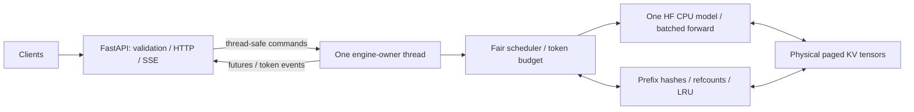
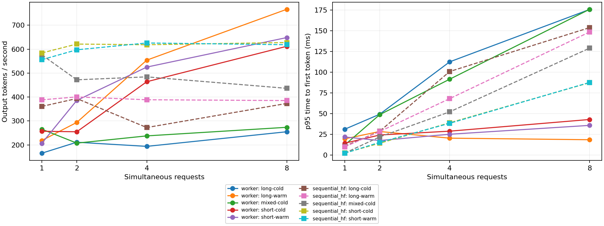

# mini-vLLM

CPU-only educational inference infrastructure built on Hugging Face model layers.
The supported `ContinuousBatchEngine` combines continuous batching, chunked
prefill, a physical paged KV pool, and shared prefix caching. A FastAPI server
serves all clients through one engine and one model in a dedicated owner thread.
This is a reference implementation for learning inference systems; it is not a
full vLLM replacement or a fused GPU paged-attention kernel.



## Setup

Use **Python 3.12**. The recorded Windows runs use Python 3.12.8, Torch 2.15.0 CPU,
and Transformers 5.23.0. Direct dependencies are pinned in `requirements.txt`.

```sh
python -m venv .venv
# Windows PowerShell:
.venv\Scripts\Activate.ps1
# Linux/macOS: source .venv/bin/activate
python -m pip install -r requirements.txt
python -m pip install --no-deps -e .
python -m unittest discover -s tests -v
python -m ruff check mini_vllm tests benchmarks
python -m ruff format --check mini_vllm tests benchmarks
```

For a CPU-only Linux Torch installation, install the matching CPU wheel before
the requirements: `python -m pip install torch==2.15.0 --index-url https://download.pytorch.org/whl/cpu`.
The engine always places its model and KV tensors on CPU.

Tests use seeded, in-memory GPT-2 models and do not download weights. The first
server/real-model benchmark startup may download `sshleifer/tiny-gpt2`; model
downloads and loading are startup costs and are excluded from inference timing.
For a pre-cached model, set `HF_HUB_OFFLINE=1` to avoid Hub checks.

## Run the API

```sh
python -m mini_vllm --model sshleifer/tiny-gpt2 --num-blocks 256 --block-size 16 --max-batch-tokens 128 --host 127.0.0.1 --port 8000
# Equivalent default configuration:
python -m uvicorn mini_vllm.server:app --host 127.0.0.1 --port 8000
```

Run exactly **one server process/worker** to retain the shared model/cache.
The CLI also accepts `--max-active-requests`, `--max-queue-size`,
`--max-new-tokens`, and `--log-level`. Environment equivalents are
`MINI_VLLM_MODEL`, `MINI_VLLM_NUM_BLOCKS`, `MINI_VLLM_BLOCK_SIZE`,
`MINI_VLLM_MAX_BATCH_TOKENS`, `MINI_VLLM_MAX_ACTIVE_REQUESTS`,
`MINI_VLLM_MAX_QUEUE_SIZE`, and `MINI_VLLM_MAX_NEW_TOKENS`.
Defaults: 8 active requests, 64 queued requests, and 128 new tokens per request.

```sh
curl http://127.0.0.1:8000/health
curl http://127.0.0.1:8000/ready
curl -X POST http://127.0.0.1:8000/generate -H "Content-Type: application/json" -d '{"prompt":"Hello world","max_tokens":12}'
curl -i -N -X POST http://127.0.0.1:8000/generate/stream -H "Content-Type: application/json" -d '{"prompt":"Hello world","max_tokens":128}'
curl -X POST http://127.0.0.1:8000/requests/REQUEST_ID/cancel
```

On Windows use `curl.exe` for curl syntax. A quoting-independent PowerShell
example is:

```powershell
Invoke-RestMethod http://127.0.0.1:8000/generate -Method Post -ContentType application/json -Body (@{prompt='Hello world';max_tokens=12} | ConvertTo-Json)
```

`/health` reports process liveness. `/ready` returns 200 with `{"ready":true}`
after initialization and 503 with `{"ready":false}` otherwise. Startup model
errors fail initialization. The normal response has `request_id`, generated
`text` (excluding the prompt), `generated_tokens`, and `finish_reason` (`length`,
`eos`, or `cancelled`). `max_tokens` limits newly generated IDs, including EOS.

The stream returns an `X-Request-ID` header immediately; use that ID from another
client to cancel a queued/running request. It sends ordered `token` events with
`request_id`, `token_id`, and a text delta, followed by exactly one `done` event.
An execution failure sends a terminal `error` event. Concatenate text deltas;
GPT-2 byte tokens may yield empty deltas until a complete UTF-8 character is
available. Cleanup of tokenization spaces is disabled. The `done` event includes
a `text` tail (normally empty; cancellation may flush an incomplete character).
Token deltas plus that tail reproduce the normal final text.

Cancellation returns `{"request_id":"...","cancelled":true}` for live requests.
Unknown or terminal IDs return 404, including repeated cancellation. Cancellation
and disconnect cleanup run between forwards and release request references once.
Shutdown stops admission, cancels outstanding work, joins the owner thread, and
evicts the remaining cache-only blocks.

Invalid payloads, whitespace/empty prompts, invalid token limits, or
`prompt_tokens + max_tokens` beyond model context return 422. A full queue returns
429. Unavailable workers, a request larger than the entire KV pool, or model
errors return 503 with a deliberate message; internal tracebacks stay in logs.
`/docs` exposes the HTTP schema. Sampling is deterministic greedy decoding.

## Engine design

- **Continuous batching:** new requests join between model steps. Each step
  performs one actual model forward over the selected rows; finished rows are
  removed immediately. Requests deferred by the token budget get priority on
  the next iteration. Pending admission uses FIFO order.
- **Chunked prefill:** prompt work is split under `max_batch_tokens`. Incomplete
  prefill never samples a token. Decode forwards only the next uncomputed token.
- **Physical KV:** fixed `[layers, blocks, block_size, heads, head_dim]` key/value
  tensors store real per-layer KV. Request block tables map logical positions to
  physical slots. CPU attention gathers temporary dense KV tensors, so gather,
  scatter, padding, and Python overhead remain substantial.
- **Prefix reuse:** chained full-block hashes include preceding context and a
  digest of model instance, revision, configuration, dtype, layout and block size.
  Lookup stops at the first missing block. A full-prompt hit drops its final
  block so a real suffix forward still produces logits. Partial blocks are
  private. Published blocks reject writes, and publication happens only after
  the model has written every KV layer successfully.
- **Ownership:** allocation, each borrower, and cache retention each own one
  reference. Duplicate computation retains one canonical cached copy; the other
  request keeps its private copy until finish. LRU lookup refreshes recency;
  memory pressure evicts only cache-sole-owner blocks. The scheduler considers
  that reclaimable storage even when the free-block count is zero.
- **Failure and memory admission:** model failure rolls back new allocations
  without publishing partial writes. Serving releases failed request ownership.
  Admission reserves each active request's worst-case block demand for
  `prompt_tokens + max_tokens - 1` computed tokens. This conservative bound
  avoids partially-prefilled requests deadlocking the pool, but may serialize
  work that could fit with more aggressive prefix-aware admission.
- **Concurrency:** only the owner thread mutates the model, tokenizer, scheduler,
  cache and registry. HTTP handlers use thread-safe commands, futures and event
  queues. Idle workers block on a queue. Terminal history is bounded to 256
  small records; token events are bounded by the requested output length.

For direct engine use call `add_request`, `step`, `cancel_request`, and
`is_complete`; `step` returns a mapping of request IDs to new token IDs. Completed
text and metadata remain in `results`/`completions` until `forget_result` is
called. The server calls it automatically. `CachedContinuousEngine`/`HFRunner`
and `LLMEngine` are legacy/reference examples retained for regression tests.
GPT-2 is the verified architecture; other full-attention models require separate
cache and tokenizer compatibility verification.

## Benchmarks and profiling

```sh
python -m benchmarks.benchmark_prefix --iterations 5 --output benchmarks/results/prefix.json
python -m benchmarks.benchmark_serving --iterations 3 --output benchmarks/results/serving.json --profile benchmarks/results/serving.prof
python -m pstats benchmarks/results/serving.prof
python -m benchmarks.smoke_http
# Download-free versions of either benchmark:
python -m benchmarks.benchmark_prefix --offline --iterations 5
python -m benchmarks.benchmark_serving --offline --iterations 3 --output benchmarks/results/offline.json
```

The serving harness tests concurrency 1/2/4/8, short/long/mixed prompts, and cold
and warm shared prefixes. It compares the shared worker with sequential HF
autoregressive **cached** decode using the exact same weights, float32 precision,
prompts, output bounds, CPU thread count, and greedy policy. Every timed pair
checks exact output IDs. Both backends warm up; model loading and warm-prefix
priming are excluded. It measures the in-process serving boundary, excluding
HTTP and network overhead. Simultaneous arrivals share a start time, so the
sequential baseline's TTFT/latency include queueing behind earlier requests.

JSON contains every trial, mean/median throughput, per-trial p50/p95 TTFT and
end-to-end latency, mean inter-token latency, cached tokens/reused blocks,
batch shapes, free blocks/cache occupancy, sampled peak RSS, and environment
metadata/model revision. Total tokens/sec counts logical prompt plus generated
tokens, including cached prompt tokens. RSS samples every millisecond and may
miss brief peaks. The `.prof` file profiles the owner thread and includes setup,
warmup, queue waits and inference; it is not an inference-only wall-time measure.

Recorded measurements and interpretation are in
[benchmarks/results/README.md](benchmarks/results/README.md).



CPU batching can lose to sequential HF on short requests. Tiny GPT-2 is a
correctness/systems smoke model, not a representative language-quality or
production-performance benchmark. These measurements do not establish GPU-level
vLLM performance. The server is intended for local learning; authentication,
rate limiting, CUDA/FlashAttention, speculative decoding, tensor parallelism,
multi-node routing and distributed caches are outside this release.

## Verification and roadmap

[docs/verification.md](docs/verification.md) records the test baseline, correctness
checks, fresh-install validation and real HTTP smoke. Future work can investigate
incremental detokenization cost, fewer dense KV copies, prefix-aware admission,
and additional verified architectures before attempting GPU or distributed work.
Version 0.1.0 is defined in the package/HTTP app; publishing and a Git tag are
optional release operations.
