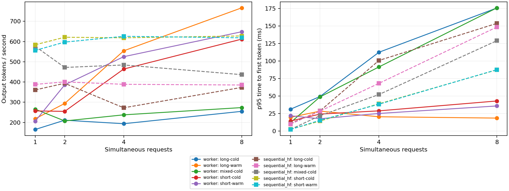
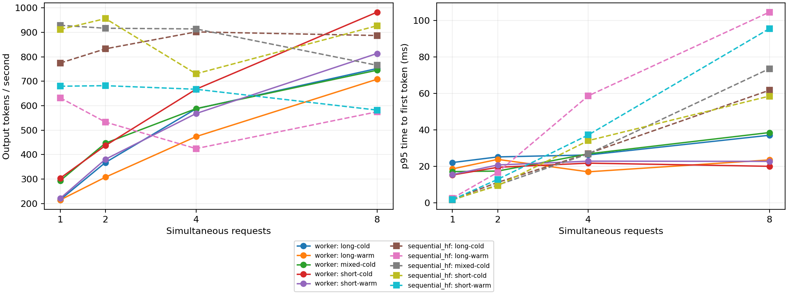

# Recorded CPU measurements

Recorded on Windows 11 with Python 3.12.8, CPU Torch 2.15.0, Transformers 5.23.0,
float32 and one Torch thread. CPU: AMD64 Family 23 Model 104 Stepping 1,
AuthenticAMD; 8 logical CPUs; 7,866,544,128 bytes system RAM.
Real model: `sshleifer/tiny-gpt2`, revision
`5f91d94bd9cd7190a9f3216ff93cd1dd95f2c7be`.
Block size 4, 256 blocks, token budget 128, greedy decoding, seed 17.

## Reproduction and artifacts

```sh
python -m benchmarks.benchmark_prefix --iterations 5 --output benchmarks/results/prefix-tiny-gpt2.json
python -m benchmarks.benchmark_serving --iterations 3 --output benchmarks/results/serving-tiny-gpt2.json --profile benchmarks/results/serving-tiny-gpt2.prof
python -m benchmarks.benchmark_prefix --offline --iterations 5 --output benchmarks/results/prefix-offline.json
python -m benchmarks.benchmark_serving --offline --iterations 3 --output benchmarks/results/serving-offline.json
```

- [Real-model prefix trials](prefix-tiny-gpt2.json): five cold/warm pairs, with
  logits verified against full-prompt reference and matching greedy output.
- [Real-model serving trials](serving-tiny-gpt2.json): 120 backend trials,
  5 workloads × 4 concurrency levels × 3 repeats × 2 backends. Every worker
  trial matches the sequential HF cached-decode token IDs exactly.
- [Offline prefix trials](prefix-offline.json) and
  [offline serving trials](serving-offline.json) use an in-memory GPT-2 with
  2 layers, width 24, vocabulary 97, and an integer tokenizer.
- [Owner-thread profile](profile-summary.txt) provides cumulative call timings.
  Regenerate raw `.prof` files with `--profile`; they are ignored by Git.

## Observations

In the recorded real-model prefix run, both prompts have 83 tokens. The warm
request reuses 80 cached tokens and executes 3 real input tokens. Median prefill
was about **10.30 ms cold / 2.81 ms warm**, with means **11.73 / 2.83 ms** across
five pairs. These timings include scheduling and first sampling. They exclude
model loading, downloads, and warmup; the input-token reduction is independently
verified rather than inferred from timing.

For the real-model **long/warm** workload (8 new tokens per request), mean output
throughput at concurrency **1, 2, 4, 8** was approximately:

- Shared worker: **218.5, 294.1, 554.0, 766.3 output tokens/sec**.
- Sequential HF cached decode: **388.3, 400.5, 388.7, 385.3 output tokens/sec**.

At concurrency 8, mean per-trial p95 TTFT for that workload was **18.64 ms** for
the worker and **148.73 ms** for sequential HF, including the baseline's queue
wait. At concurrency 1 with a short cold prompt, the worker was slower:
**257.2 vs 584.0 output tokens/sec**, and p95 TTFT **14.43 vs 2.63 ms**.
Long cold prompts also expose substantial CPU paging/padding overhead; inspect
the full workload curves before drawing conclusions. Peak sampled process RSS
across real-model trials was approximately **469.5 MiB**, including resident model
and runtime memory. Warm long-prefix concurrency-8 trials reused 640 tokens /
160 block references across requests, ending with 36 cached physical blocks and
220 free blocks.





## Profiling and limits

An initial owner-thread profile identified repeated full-prefix hashing and JSON
serialization on decode steps. The implementation now hashes each newly
committed block once and hashes the compatibility namespace into a fixed digest.
The retained profile is from the final implementation. Dense KV gathers/scatters,
temporary padding, linear layers, tokenization/detokenization and queue waits
remain visible costs. The profile includes setup/warmup/idle time; cumulative
times overlap and should not be added as disjoint categories.

The measurements cover the in-process worker boundary, excluding HTTP/network.
Both backends use the same loaded model and input/output bounds; HF keeps its
autoregressive KV within each request and processes concurrent arrivals
sequentially. Warm cache priming occurs outside timing. Backend order alternates
across repeats. Throughput summaries are means of trial throughputs; TTFT
comparisons above are means of each trial's p95, not pooled percentiles.
Total-token throughput includes logically reused input tokens. RSS is sampled
at 1 ms and can miss brief peaks.

Three repeats and tiny synthetic workloads are a smoke benchmark, not a stable
capacity estimate. Windows scheduling and background load create noise. No
claim is made that this CPU reference outperforms HF in every workload, or that
it approaches a fused GPU vLLM implementation.
